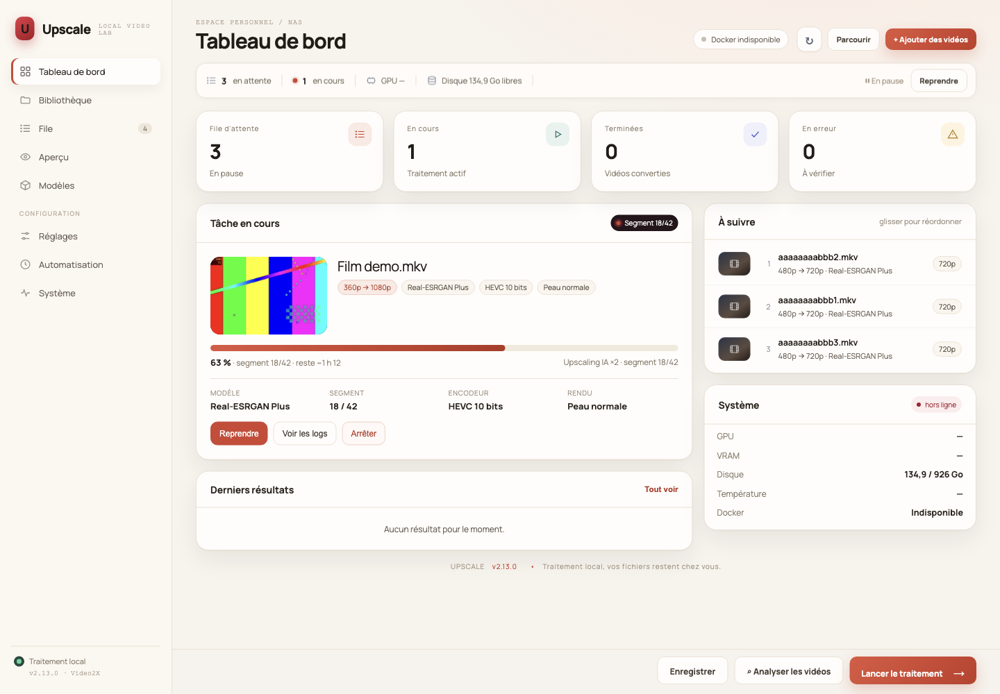

# Upscale

Upscale est une application auto-hébergée qui analyse une bibliothèque vidéo et lance des traitements d'upscaling IA avec Video2X / Real-ESRGAN. Elle fournit une interface web en français sur le port **27000**, une file de tâches persistante, un comparateur avant/après et des automatisations (dossier surveillé, plage horaire, notifications, Jellyfin/Emby/Plex).

Le projet cible notamment les NAS sous Ubuntu équipés d'un GPU AMD compatible Vulkan, comme la Radeon RX 5500 XT.

> La qualité dépend surtout du modèle et de la source. Utilise **Aperçu** pour comparer les modèles sur un extrait avant de lancer toute ta bibliothèque.

## Aperçu

*Capture de démonstration : la miniature de la tâche en cours est extraite de la vidéo elle-même.*

## Fonctionnalités

**Qualité**
- Real-ESRGAN via Video2X (Plus, Plus Anime, AnimeVideo v3) et **modèles personnalisés** installés depuis l'interface en collant un lien OpenModelDB (conversion et vérification automatiques), avec le plus petit facteur suffisant (×2, ×3 ou ×4 selon le modèle).
- Modèle **Automatique** : un modèle de vision Ollama regarde trois images de la vidéo et choisit entre animation et prise de vue réelle.
- Désentrelacement automatique (bwdif), débruitage optionnel avant l'IA (hqdn3d ou nlmeans), doublement des images par seconde (RIFE, expérimental).
- Rendu **Peau normale** : mélange IA / original et grain léger contre l'effet « peau cireuse ».
- Format d'affichage respecté (DVD anamorphiques), sortie en pixels carrés.
- Encodage final HEVC 10 bits par défaut, ou H.264, AV1 10 bits, matériel VAAPI (H.264/HEVC) sur GPU AMD.
- Audio, sous-titres (mov_text converti en SRT), chapitres et polices jointes conservés ; vérification automatique de la durée et des pistes du fichier produit.

**Fiabilité**
- Traitement par **segments** (3 min par défaut) : une coupure, un redémarrage ou une pause ne fait perdre que le segment en cours ; « Relancer » reprend là où la tâche s'était arrêtée.
- Espace disque borné : la découpe est suspendue tant que plus de deux segments attendent l'IA ; vérification avant et pendant le traitement, avec ré-estimation d'après le débit réel mesuré.
- **Réglages figés par tâche** au moment de la mise en file : changer un réglage n'affecte pas les vidéos déjà en attente.
- Par défaut, les originaux ne sont jamais modifiés, une sortie existante n'est jamais écrasée et l'arborescence relative est conservée. En option, la nouvelle version **remplace l'original** (gardé en corbeille, restaurable).
- **Remplacement après coup** : dans la file, une vidéo déjà terminée peut remplacer son original par sa sortie du dossier de destination (bouton par tâche ou action groupée). L'original part dans la corbeille et reste restaurable.
- **Dossier de travail séparé** : les segments et le fichier temporaire peuvent être écrits hors de la bibliothèque (par exemple sur un SSD) ; seule la sortie finale apparaît dans la destination.

**Organisation**
- Profils par dossier (ex. Animation → AnimeVideo v3, Films → Plus 1080p HEVC).
- Aperçu multi-modèles avec comparateur à curseur.
- **Tableau de bord** : tâche en cours, progression, temps restant, GPU, disque, prochaines tâches et derniers résultats, avec une **miniature extraite de la vidéo**.
- File d'attente : vignettes des vidéos, réordonner par glisser-déposer (tableau de bord et file, tâches en attente) ou avec les boutons, relancer, supprimer, filtrer, paginer ; progression et temps restant.
- **Dossier parent** : sélectionne un dossier et tous ses sous-dossiers sont analysés ; les dossiers source imbriqués sont fusionnés et la destination peut être un sous-dossier de la source (elle est exclue du scan).
- Dossier surveillé, plage horaire (ex. 22 h – 7 h), notifications ntfy / Gotify / webhook, actualisation Jellyfin / Emby / Plex, suffixe de nom de fichier.
- Statistiques GPU en direct (charge, température, VRAM, puissance).
- Fichiers produits attribués au propriétaire de la vidéo d'origine (ou à PUID/PGID), jamais à root par défaut.
- Authentification par mot de passe (lecture seule sans mot de passe), protection CSRF et en-têtes de sécurité.

## Prérequis

- NAS ou serveur Ubuntu 22.04/24.04 (ou Linux compatible Docker).
- Docker Engine et Docker Compose v2.
- GPU AMD exposé via /dev/dri et pilote Mesa Vulkan opérationnel (paquets hôte mesa-vulkan-drivers et vulkan-tools).
- Accès au dépôt GitHub (public) : le clonage HTTPS suffit, aucune clé SSH n'est nécessaire.

### À propos de la RX 5500 XT

La présence de la carte dans lspci ne suffit pas : vulkaninfo --summary doit afficher le GPU AMD, et non uniquement llvmpipe (rendu logiciel CPU). La RX 5500 XT sait aussi encoder en H.264 et HEVC matériel (VAAPI).

## Installation rapide (recommandée)

~~~bash
git clone https://github.com/oliv2776/Upscale.git
cd Upscale && sudo bash install.sh
~~~

Le script install.sh :
- installe les dépendances système manquantes (Docker/Compose, Git, pilotes/outils Vulkan) et active Docker au démarrage ;
- crée /data/videos et /data/videos_upscaled, attribués à l'utilisateur qui a lancé sudo ;
- détecte le GPU piloté par amdgpu (même si un iGPU occupe card0), ses GID et son périphérique VAAPI ;
- génère .env avec ton fuseau horaire, ton utilisateur de session (PUID/PGID) et un **mot de passe aléatoire** pour l'interface ; si .env existe déjà, il n'ajoute que les clés manquantes ;
- télécharge l'image Video2X à l'avance (plusieurs Go) ;
- construit et démarre Upscale sur le port **27000** (ou celui défini dans .env).

Ouvre ensuite http://IP_DU_NAS:27000 (hostname -I donne l'adresse). Pour un autre point de montage : sudo UPSCALE_HOST_DATA=/chemin/du/stockage bash install.sh — l'interface affiche toujours ce stockage sous /data. Vidéos sur plusieurs disques : voir **Plusieurs disques** ci-dessous (ou directement sudo UPSCALE_DISQUES="/mnt/disque2 /mnt/disque3" bash install.sh).

**Mise à jour (sans perdre le travail en cours) :**

~~~bash
git pull
bash update.sh          # pause au segment, sauvegarde de la base, reconstruction, reprise
~~~

update.sh construit d'abord la nouvelle image (le traitement continue), met ensuite la file en pause et attend la fin du **segment en cours**, sauvegarde la base dans backups/, bascule vers la nouvelle image puis remet la file en route. Les segments déjà encodés, la file, les réglages et les dossiers `.upscale-*` sont conservés. Le script passe par la base : il fonctionne même sans mot de passe. Options : `-y` (sans confirmation), `--sans-sauvegarde`, et `UPSCALE_UPDATE_TIMEOUT` (secondes, 900 par défaut).

Sans le script, `docker compose up -d --build` reprend aussi au segment suivant, mais le segment en cours est refait.

**Vérification depuis l'interface** : **Système → Version** interroge GitHub Releases et indique si une version plus récente existe, avec le lien des notes et la commande `update.sh` à copier. La vérification n'est qu'informative : le déclenchement automatique demanderait un service hôte supplémentaire (voir la proposition d'interface).

L'historique, les réglages et les tâches en attente sont conservés (migration automatique de la base).

> **Ne lance jamais `docker compose down -v`** : l'option `-v` supprime le volume `uscale-state` (file, réglages, historique, modèles installés).

> **2.9 — mode réseau local** : sans UPSCALE_PASSWORD, l'interface est en **lecture seule par défaut**. Le bandeau (ou **Système → Accès**) permet d'autoriser les actions sans mot de passe en un clic, mémorisé en base et réversible. `UPSCALE_ALLOW_ANONYMOUS=1` force ce mode ; un mot de passe reste prioritaire. install.sh génère un mot de passe et l'affiche à la fin de l'installation.

> **Ancien nom « Uscale »** : le projet s'appelle désormais Upscale. Les anciennes variables USCALE_* de ton .env restent lues (les nouvelles UPSCALE_* sont prioritaires), la base et le volume de données sont repris tels quels, et les conteneurs ou dossiers de travail d'une tâche interrompue sous l'ancien nom sont récupérés. Rien à faire ; tu peux renommer les variables à ton rythme.

## Installation manuelle

### 1. Docker et outils système

~~~bash
docker --version && docker compose version
sudo systemctl enable --now docker
sudo apt update && sudo apt install -y git mesa-vulkan-drivers vulkan-tools
~~~

Si Docker n'est pas installé : https://docs.docker.com/engine/install/ubuntu/. FFmpeg est fourni dans le conteneur.

### 2. GPU AMD

~~~bash
ls -l /dev/dri
vulkaninfo --summary
stat -c '%n : GID=%g' /dev/dri/card* /dev/dri/renderD*
~~~

Si vulkaninfo n'affiche que llvmpipe, arrête-toi : le traitement utiliserait le CPU. Le GID de card* va dans VIDEO_GID, celui de renderD* dans RENDER_GID.

### 3. Dossiers vidéo

~~~bash
sudo mkdir -p /data/videos /data/videos_upscaled
sudo chown "$USER": /data/videos /data/videos_upscaled
~~~

Le dossier de destination peut être à l'intérieur d'un dossier source (il est exclu du scan), mais un dossier source ne peut pas être à l'intérieur de la destination.

### 4. Configuration

~~~bash
git clone https://github.com/oliv2776/Upscale.git && cd Upscale
cp .env.example .env && nano .env
~~~

Les variables principales sont décrites dans .env.example et dans la section **Variables d'environnement** plus bas. Ne copie pas aveuglément les GID d'exemple (44 et 109).

### 5. Démarrage

~~~bash
docker compose up -d --build
docker compose logs -f --tail=200 upscale
~~~

Au premier traitement, Docker peut télécharger l'image Video2X (plusieurs Go).

## Utilisation

1. **Configuration** : choisis un ou plusieurs dossiers source (**+ Ajouter un dossier source**, sur n'importe quel disque), la destination et éventuellement un **dossier de travail** (SSD, hors bibliothèque), la hauteur maximale des sources à traiter (480p pour traiter 240p, 360p et 480p), la résolution de sortie, le modèle, les filtres et l'encodeur. Clique sur **Enregistrer**.
2. **Aperçu** : choisis une vidéo, un instant de départ et quelques modèles, puis **Générer l'aperçu**. Les aperçus passent devant la file (même en pause), et restent visibles dans la file et sur le tableau de bord avec un badge **Aperçu**. Compare ensuite deux variantes avec le curseur ; l'original agrandi sans IA sert de référence. Les **aperçus récents** sont listés sous le comparateur : **Supprimer** efface l'aperçu et ses fichiers.
3. **Profils par dossier** (facultatif) : par exemple /data/videos/Animation → AnimeVideo v3. Un fichier utilise le profil du dossier le plus précis qui le contient ; les champs « Global » reprennent les réglages généraux.
4. **Analyser les vidéos** compte les fichiers éligibles et affiche leur répartition par résolution (< 360p, 360–480p, > 480p) ; **Lancer le traitement** les met en file. Un dossier parent suffit : les sous-dossiers sont inclus (option **Inclure tous les sous-dossiers**). Si des sous-dossiers sont déjà listés, choisir le parent les fusionne ; la destination peut être un sous-dossier de la source, elle est ignorée par l'analyse.
5. **File de traitement** : suis la progression par segment, réordonne les tâches **en attente** par glisser-déposer (ou ⤒ ↑ ↓), relance, supprime ou consulte les journaux. Pour une vidéo terminée, **Remplacer l'original** déplace sa sortie du dossier de destination à la place de l'original (ou **Remplacer les originaux** pour toutes les tâches terminées) ; l'original va dans la corbeille selon `trash_days`.

Les sorties reprennent l'arborescence du dossier source en .mkv, avec le suffixe éventuel (Film (2001).avi → Film (2001) - 720p IA.mkv). Si deux sources du même dossier ne diffèrent que par l'extension (film.avi et film.mp4), les sorties deviennent film.avi.mkv et film.mp4.mkv. Les vidéos déjà présentes à destination ou déjà traitées (même chemin, taille et date) sont ignorées.

## Plusieurs disques

Docker isole le conteneur : Upscale ne voit que les dossiers du NAS qu'on lui confie. Le disque principal (UPSCALE_HOST_DATA dans .env) apparaît sous **/data** ; chaque disque supplémentaire apparaît sous **/disques/&lt;Nom&gt;**. Pour en ajouter un, sur le NAS :

~~~bash
cd Upscale
sudo bash bibliotheques.sh ajouter /mnt/disque2/films            # visible sous /disques/films
sudo bash bibliotheques.sh ajouter /srv/series "Séries"         # nom choisi : /disques/Séries
sudo bash bibliotheques.sh liste
sudo bash bibliotheques.sh retirer films                        # ne touche pas aux fichiers
~~~

Le script écrit docker-compose.override.yml (chargé automatiquement par Docker Compose, ignoré par git, donc conservé lors des git pull) puis redémarre Upscale. Ensuite, dans l'interface :

- l'explorateur (**Parcourir**) s'ouvre sur la liste des disques, avec l'espace libre de chacun ;
- **+ Ajouter un dossier source** permet d'analyser plusieurs dossiers à la fois, sur des disques différents ;
- la destination peut être sur n'importe quel disque (un sous-dossier, pas la racine du disque) ;
- le dossier de travail (optionnel) doit lui aussi être sous `/data` ou `/disques/...` pour que Video2X puisse y accéder. Un SSD monté via `bibliotheques.sh` est idéal.

Avec un seul dossier source, les sorties vont directement dans la destination. Avec plusieurs, chacune a son sous-dossier au nom du dossier source (/data/out/Films/…, /data/out/Séries/…) ; les vidéos déjà traitées avant l'ajout d'une source ne sont pas refaites. En mode remplacement, chaque vidéo est remplacée dans son propre dossier et la corbeille se trouve dans le dossier source concerné.

En mode standard, Upscale lit ses propres montages et donne exactement les mêmes disques au conteneur Video2X : rien d'autre à configurer. Le mode sans socket (docker-compose.local.yml) prend aussi en compte docker-compose.override.yml quand il est relancé par bibliotheques.sh.

## Paramètres de traitement

| Paramètre | Rôle |
|---|---|
| Hauteur source maximale | Exclut les vidéos plus grandes que la valeur choisie |
| Hauteur de sortie | 480p à 2160p, format d'affichage conservé |
| Modèle IA | Plus (réel), Plus Anime (animation détaillée), AnimeVideo v3 (animation, ×2/×3/×4, rapide), Automatique (Ollama). L'ancien choix « General v3 », absent de Video2X 6.4, est remplacé automatiquement par Plus |
| Désentrelacement | Automatique (selon ffprobe), toujours ou jamais |
| Débruitage | Aucun, léger / moyen (hqdn3d), fort (nlmeans, pour VHS, plus lent) |
| Images par seconde | Inchangées ou doublées avec RIFE (expérimental, avant l'upscaling) |
| Encodeur | HEVC 10 bits (défaut, ~40 % plus léger que H.264), H.264 (compatibilité maximale), AV1 10 bits (le plus léger, lent), H.264/HEVC VAAPI (matériel, rapide) |
| CRF | 16 par défaut pour H.264 ; converti pour HEVC (+2), AV1 (+10) et VAAPI (QP +4) |
| Preset | Vitesse de l'encodeur logiciel (converti pour SVT-AV1) |

### Comment se déroule une tâche

1. Préparation : filtres éventuels puis découpe de la vidéo en segments sans perte (FFV1, sur tous les cœurs du processeur) à la résolution source. **La découpe et l'IA avancent en même temps** : chaque segment est agrandi par la carte graphique dès que le processeur l'a terminé (la file affiche alors « segment 3/~40 · découpe 35 % »). Avec RIFE, l'interpolation est faite sur la vidéo entière à la résolution source avant la découpe.
2. Pour chaque segment : Video2X agrandit le segment (intermédiaire sans perte), puis FFmpeg l'encode à la taille finale. L'intermédiaire est aussitôt supprimé. Si l'IA prend du retard, la découpe est suspendue (SIGSTOP) dès que plus de deux segments attendent, puis reprise : l'espace disque reste borné.
3. Assemblage : les segments encodés sont concaténés sans réencodage, avec l'audio, les sous-titres, les chapitres et les polices de l'original.
4. Vérification : durée, nombre de pistes audio et de sous-titres (et images/s avec RIFE). Une anomalie est signalée par ⚠ dans la file, sans supprimer le fichier.

Les fichiers de travail sont dans un dossier caché .upscale-ID à côté de la sortie. Ils sont conservés si la tâche échoue ou est interrompue (pour reprendre) et supprimés à la fin, à l'annulation ou à la suppression de la tâche. Un changement de réglages qui affecte le résultat repart de zéro.

**Pause** : la vidéo en cours s'arrête à la fin de son segment et reprendra à partir du suivant. **Arrêter** interrompt immédiatement et supprime les fichiers de travail.

**Espace disque** : Upscale estime l'espace nécessaire (quelques segments en attente, un segment agrandi, la sortie) et refuse de démarrer s'il manque de la place ; pendant le traitement, l'estimation est révisée d'après le débit réellement mesuré des segments encodés, et la tâche s'arrête si l'espace libre descend sous UPSCALE_MIN_FREE_GB. Si le dossier de travail est sur un autre disque que la destination, Upscale vérifie aussi la place nécessaire à la copie finale.

**SSD ou disque dur ?** L'upscaling est surtout limité par le GPU (ou le CPU), pas par le disque : un SSD n'accélère pas l'inférence. Il aide surtout à éviter que les écritures FFV1 des segments ne saturent un disque dur, en particulier en 4K, et il garde la bibliothèque propre. La lecture de la source reste sur son disque d'origine ; la copie finale du SSD vers la bibliothèque ajoute un transfert en fin de tâche. Le gain est donc variable, souvent modeste, mais le dossier de travail sur SSD est recommandé pour la propreté et la réactivité.

### Rendu « Peau normale »

Real-ESRGAN Plus reconstruit bien les détails des vidéos filmées, mais il a tendance à lisser la peau : pores, grain et texture disparaissent, ce qui donne un aspect « cireux » ou « plastique ». Le réglage **Rendu** corrige cela :

| Rendu | Effet |
|---|---|
| IA pure | 100 % Real-ESRGAN (comportement d'origine) |
| Peau normale | 70 % IA + 30 % original agrandi classiquement (Lanczos), puis grain léger : netteté de l'IA, texture naturelle de la peau |
| Personnalisé | Part de l'IA de 30 à 100 % et grain (aucun, léger, moyen) au choix |

Le mélange se fait image par image pendant l'encodage, sans calcul IA supplémentaire. Le rendu se choisit globalement ou par dossier (colonne **Rendu** des profils) ; l'**Aperçu** ajoute pour chaque modèle une variante « · Peau normale » à comparer avec le curseur. Le grain augmente un peu la taille des fichiers.

### Modèles personnalisés

En plus des trois modèles de Video2X, Upscale accepte des modèles de la communauté, gérés entièrement depuis l'interface (panneau **Modèles IA**) : installation, nom, facteur, taille des tuiles, suppression. Un modèle installé apparaît partout (modèle général, profils par dossier, Aperçu).

**Installer un modèle OpenModelDB** : ouvre la page du modèle sur [openmodeldb.info](https://openmodeldb.info), copie son adresse (par ex. `https://openmodeldb.info/models/2x-LiveActionV1-SPAN`), colle-la dans **Lien du modèle** puis clique sur **Installer**. Upscale :

1. lit la fiche du modèle (nom, facteur, architecture, licence) et télécharge le fichier, en vérifiant sa taille et son empreinte SHA-256 ;
2. le convertit au format ncnn si besoin. La première conversion installe le convertisseur (torch CPU, spandrel, pnnx : environ 1 Go dans le volume d'état, une seule fois) ;
3. le fait tourner sur le moteur Vulkan avec une image de test : il doit se charger, produire la bonne taille et le même résultat que le modèle PyTorch d'origine. Sinon, l'installation échoue avec une explication et rien n'est ajouté ;
4. l'enregistre avec son auteur, sa licence et un lien vers sa fiche.

Le suivi (téléchargement, conversion, vérification) s'affiche sous le formulaire ; le journal détaillé est disponible en cas d'échec. Un lien direct vers un fichier `.pth`, `.safetensors`, `.onnx` ou `.zip` fonctionne aussi (GitHub, Hugging Face, fichier Google Drive). On peut enfin importer un fichier depuis l'ordinateur (**Importer un fichier depuis cet ordinateur**) : `.pth`, `.safetensors`, `.onnx`, `.zip`, ou la paire ncnn `.param` + `.bin`.

- **Modèle conseillé pour la vidéo filmée** : [2xLiveActionV1_SPAN](https://openmodeldb.info/models/2x-LiveActionV1-SPAN), installable en un clic depuis le panneau. Entraîné sur les défauts de la vidéo compressée (H.264, H.265, MPEG-4, VP9, sous-échantillonnage des couleurs, flou de redimensionnements successifs, halos, crénelage) ; il ne débruite pas : garde le débruitage « Moyen ». Licence non commerciale (CC BY-NC-SA 4.0).
- **Facteur** : préfère un modèle ×2 pour du 360p → 720p, bien plus rapide qu'un ×4 réduit ensuite. Le moteur accepte ×2, ×3 et ×4.
- **Architectures** : SPAN, Compact et ESRGAN fonctionnent et sont rapides. Les architectures lourdes (DAT, HAT, ATD, RGT...) sont refusées si le moteur ne sait pas les exécuter, et seraient de toute façon très lentes sur une RX 5500 XT.
- **Hébergeurs** : les dossiers Google Drive et Mega ne sont pas téléchargeables automatiquement ; télécharge alors le fichier toi-même et importe-le.
- **Tuiles** : en cas de mémoire vidéo insuffisante, choisis 256 ou 128 px (un peu plus lent).
- **Licences** : chaque modèle a la sienne (affichée dans le tableau). Beaucoup interdisent l'usage commercial.

Video2X n'acceptant que ses propres modèles, les modèles personnalisés passent par le moteur ncnn [upscayl-bin](https://github.com/upscayl/upscayl-ncnn) (fork maintenu de realesrgan-ncnn-vulkan, Vulkan, compatible AMD), installé dans l'image. Il travaille image par image : les segments sont alors plus courts (30 s, UPSCALE_CUSTOM_SEGMENT_SECONDS) pour limiter l'espace disque, et le traitement est un peu plus lent qu'avec Video2X. Les fichiers des modèles sont conservés dans le volume uscale-state.

### Aperçu fidèle : « Votre configuration »

Chaque aperçu commence par la variante **Votre configuration** : l'extrait est traité exactement comme le serait le fichier final (modèle du profil du dossier ou réglage général, débruitage, désentrelacement, rendu, encodeur et CRF), puis converti pour le navigateur. Les modèles cochés sont ajoutés pour comparaison, en IA pure et, si la case est cochée, en « Peau normale ».

### HEVC par défaut

Depuis la version 2.2, l'encodeur par défaut est HEVC 10 bits : environ 40 % plus léger que H.264 à qualité égale, et moins de bandes dans les dégradés. Les réglages enregistrés avec l'ancien défaut (H.264) sont convertis une fois à la mise à jour ; un choix fait ensuite est respecté. Les vieux téléviseurs, certains navigateurs et appareils ne lisent pas le HEVC 10 bits : choisis H.264 (globalement ou dans un profil) si tu en as besoin. Jellyfin et Plex peuvent aussi le transcoder à la volée.

### Remplacer les fichiers d'origine

Option **Remplacer les fichiers d'origine** (section Bibliothèque vidéo) : la nouvelle version prend la place de l'original dans son dossier (film.avi → film.mkv, film.mkv → film.mkv) et le dossier de destination n'est plus utilisé. Le dossier de travail, s'il est défini, reste utilisé pour les fichiers temporaires. Garde-fous :

- l'original est déplacé dans **.upscale-corbeille** à la racine du dossier source (même arborescence) et conservé 7, 30 (défaut) ou 90 jours, ou supprimé immédiatement si tu le choisis ;
- tant qu'il est dans la corbeille, **Restaurer l'original** (dans la file) supprime la version Upscale et remet l'original à sa place ;
- si la vérification automatique relève un problème (durée, pistes), rien n'est remplacé : la nouvelle version est posée à côté (« film - Upscale.mkv ») et la tâche est signalée ⚠ ;
- un fichier produit par Upscale n'est jamais retraité, même s'il reste sous la hauteur maximale, et les dossiers .upscale-* ne sont jamais analysés ;
- si un autre fichier porte déjà le nom de sortie (film.mkv à côté de film.avi), la vidéo est ignorée.

Le réglage est figé dans chaque tâche au moment de la mise en file, comme les autres. La corbeille est vidée par la maintenance (au démarrage puis toutes les 6 h).

## Automatisation

- **Dossier surveillé** : le dossier source est analysé à intervalle régulier et les nouvelles vidéos sont mises en file. Les fichiers modifiés depuis moins de 2 minutes sont ignorés (copie en cours).
- **Plage horaire** : les upscalings ne démarrent qu'à l'intérieur de la plage (qui peut passer minuit, ex. 22:00–07:00, heure du fuseau TZ). Hors plage, la vidéo en cours s'arrête à la fin de son segment.
- **Notifications** : ntfy (URL du sujet, jeton optionnel), Gotify (URL du serveur + jeton d'application) ou webhook JSON (POST avec event, title, message, job_id, source, destination). Bouton **Tester la notification**.
- **Serveur multimédia** : après chaque vidéo terminée, Jellyfin ou Emby (clé API, POST /Library/Refresh) ou Plex (X-Plex-Token, actualisation de chaque bibliothèque) réanalyse ses bibliothèques. Pointe la bibliothèque du serveur sur le dossier de destination ; le suffixe aide à distinguer les versions.

Les jetons ne sont jamais renvoyés au navigateur : laisse le champ vide pour conserver le jeton enregistré.

## Ollama (facultatif)

Upscale détecte une instance Ollama (version et modèles via GET /api/version et /api/tags). Avec un modèle de vision (llava, qwen2.5vl, gemma3…) choisi dans le panneau **Connexion Ollama**, le modèle IA **Automatique** extrait trois images de chaque vidéo et demande s'il s'agit d'animation (→ AnimeVideo v3) ou de prise de vue réelle (→ Plus). En cas d'échec, Plus est utilisé ; le choix est noté dans le journal.

Par défaut, Upscale essaie http://host.docker.internal:11434 puis http://172.17.0.1:11434. Si Ollama est installé directement sur Ubuntu, il écoute souvent sur 127.0.0.1 seulement :

~~~bash
sudo systemctl edit ollama   # ajouter : [Service] puis Environment="OLLAMA_HOST=0.0.0.0:11434"
sudo systemctl daemon-reload && sudo systemctl restart ollama
~~~

N'expose pas le port 11434 sur Internet.

## Variables d'environnement

| Variable | Défaut | Rôle |
|---|---|---|
| UPSCALE_HOST_DATA | /data | Dossier des vidéos sur l'hôte (chemin absolu) |
| UPSCALE_DATA_ROOT | /data | Même dossier vu dans le conteneur et l'interface |
| UPSCALE_PORT | 27000 | Port publié |
| VIDEO_GID / RENDER_GID | 44 / 109 | GID de /dev/dri/card* et /dev/dri/renderD* |
| VIDEO2X_IMAGE | ghcr.io/k4yt3x/video2x:6.4.0 | Image Video2X (mode standard) |
| VIDEO2X_GPU | (vide) | Index du GPU Vulkan (voir **Tester le GPU**) |
| VAAPI_DEVICE | /dev/dri/renderD128 | Périphérique pour l'encodage matériel |
| UPSCALE_USER / UPSCALE_PASSWORD | admin / (généré par install.sh) | Authentification de l'interface (HTTP Basic) |
| UPSCALE_ALLOW_ANONYMOUS | 0 | Force l'accès sans mot de passe ; à 0, l'interface est en lecture seule par défaut et le mode réseau local s'active depuis l'interface |
| UPSCALE_TRUSTED_HOSTS | (vide) | Noms publics autorisés (reverse proxy, protection CSRF) ; le proxy doit conserver `Host` |
| UPSCALE_ALLOW_PRIVATE_MODEL_URLS | 0 | Autorise les liens de modèles vers des adresses privées (miroir interne) |
| UPSCALE_CONVERTER_DROP_PRIVILEGES | 1 | Exécute la conversion des modèles en « nobody » (setpriv) quand le conteneur est root |
| UPSCALE_UPDATE_CHECK | 1 | Vérifie les nouvelles releases GitHub dans **Système** (0 pour un NAS hors ligne) |
| UPSCALE_SCAN_WORKERS | 4 | Nombre de ffprobe simultanés pendant l'analyse d'une grande bibliothèque (1 à 16) |
| UPSCALE_MIN_FREE_GB | 5 | Espace libre minimal conservé |
| UPSCALE_SEGMENT_SECONDS | 180 | Durée des segments |
| UPSCALE_LOG_RETENTION_DAYS | 90 | Conservation des journaux des tâches terminées |
| UPSCALE_CONVERTER_PYTHON | (vide) | Interpréteur déjà équipé de torch, spandrel et pnnx (sinon installé automatiquement à la première conversion) |
| UPSCALE_TORCH_INDEX | https://download.pytorch.org/whl/cpu | Index de paquets pour torch (version CPU) |
| UPSCALE_MODEL_MAX_MB | 2048 | Taille maximale d'un modèle téléchargé |
| PUID / PGID | (vide) | Propriétaire imposé des fichiers produits (vide = propriétaire de la vidéo d'origine) |
| TZ | Europe/Paris | Fuseau horaire (plage horaire) |
| UPSCALE_PULL_POLICY / UPSCALE_VERSION | build / latest | Construire l'image ou utiliser celle de GHCR |

## Image publiée sur GHCR

Chaque push sur main publie ghcr.io/oliv2776/upscale:latest (et un tag par version vX.Y.Z). Pour l'utiliser au lieu de construire l'image sur le NAS, mets dans .env :

~~~dotenv
UPSCALE_PULL_POLICY=always
UPSCALE_VERSION=latest
~~~

puis docker compose pull && docker compose up -d. Le paquet GHCR suit la visibilité du dépôt (public ici) ; s'il est privé chez toi, connecte d'abord le NAS avec un jeton GitHub ayant le droit read:packages (docker login ghcr.io -u oliv2776). Pour revenir à une version précise : UPSCALE_VERSION=2.8.0.

## Mode sans socket Docker (expérimental)

Par défaut, Upscale lance Video2X dans un conteneur frère via /var/run/docker.sock, ce qui revient à lui donner les droits administrateur du NAS. La variante docker-compose.local.yml installe l'AppImage officielle de Video2X **dans** l'image Upscale et l'exécute directement avec /dev/dri : plus de socket Docker.

~~~bash
docker compose down
docker compose -f docker-compose.local.yml up -d --build
# avec des disques supplémentaires (bibliotheques.sh) :
docker compose -f docker-compose.local.yml -f docker-compose.override.yml up -d --build
~~~

Mêmes .env, données, réglages et file d'attente. Pour revenir : docker compose -f docker-compose.local.yml down && docker compose up -d. La CI construit cette image et y exécute un vrai traitement Video2X (sur Vulkan logiciel), mais elle n'a pas encore été validée sur une Radeon : teste-la sur une courte vidéo.

## Propriétaire des fichiers produits

Le conteneur tourne en root (il a besoin du socket Docker et de /dev/dri), et un service Docker n'a pas de « session » : il ne sait pas quel utilisateur l'a lancé. Sans réglage, tout ce qu'il écrit appartiendrait donc à root. Upscale choisit plutôt, dans cet ordre :

1. PUID / PGID s'ils sont définis dans .env (install.sh y met l'utilisateur qui a lancé sudo) ;
2. sinon le propriétaire de la vidéo d'origine ;
3. sinon celui du dossier de destination, puis du dossier source.

Root n'est jamais choisi par défaut. Les dossiers créés par Upscale dans la destination reçoivent le même propriétaire, et la maintenance (au démarrage puis toutes les 6 h) rend à leur propriétaire les vidéos déjà produites qui appartiendraient encore à root.

## Gestion du service

~~~bash
docker compose ps
docker compose logs -f --tail=200 upscale
docker compose restart upscale
docker compose down          # conserve le volume uscale-state et les vidéos
~~~

`docker compose down` sans `-v` ne touche ni au volume d'état, ni aux vidéos, ni aux dossiers de travail `.upscale-*` : une tâche interrompue reprend au segment suivant. `down -v` supprime la file et les réglages.

La file, les réglages, les journaux et les aperçus sont dans le volume Docker uscale-state (/app/state). Les journaux des tâches terminées sont supprimés après UPSCALE_LOG_RETENTION_DAYS jours, et seuls les 10 derniers aperçus sont gardés. Pour tout effacer sans toucher aux vidéos :

~~~bash
docker compose down
docker volume ls | grep uscale-state   # généralement upscale_uscale-state
docker volume rm upscale_uscale-state
~~~

## Dépannage

- **open …/.env: permission denied** : le fichier a été créé par sudo et appartient à root. Dans le dossier Upscale : sudo chown "$USER": .env (les versions récentes d'install.sh le font d'elles-mêmes).
- **L'interface ne répond pas** : docker compose ps, docker compose logs --tail=200 upscale, sudo ss -ltnp | grep 27000.
- **Le conteneur ne démarre pas (/dev/dri)** : Upscale a besoin de /dev/dri (encodage VAAPI, statistiques GPU). Vérifie ls -l /dev/dri sur l'hôte.
- **Le GPU n'est pas détecté** : **Tester le GPU** lance Video2X --list-devices avec les mêmes permissions que les traitements. S'il affiche plusieurs GPU (iGPU + Radeon), indique l'index de la Radeon dans VIDEO2X_GPU. Vérifie VIDEO_GID et RENDER_GID, puis docker compose up -d --build.
- **« Aucun mot de passe configuré » / interface en lecture seule** : définis UPSCALE_PASSWORD dans .env puis `docker compose up -d`. Pour assumer l'absence de mot de passe sur un réseau de confiance : UPSCALE_ALLOW_ANONYMOUS=1.
- **Une tâche échoue** : bouton **Logs** dans la file. Corrige la cause puis **Relancer** : les segments déjà encodés sont conservés.
- **Encodage VAAPI en erreur** : vérifie VAAPI_DEVICE (le renderD* de la Radeon) ; sinon utilise un encodeur logiciel.
- **Redémarrage pendant un traitement** : le conteneur Video2X orphelin est supprimé au démarrage et la tâche reprend au segment en cours.
- **L'interface ne change pas après une mise à jour** : vérifie la version en bas de page. Si ce n'est pas la dernière, le conteneur n'a pas été reconstruit : `bash update.sh`, ou `docker compose up -d --build --force-recreate`. Si la version est bonne, force le rafraîchissement du navigateur (Ctrl/Cmd + Shift + R).

## Sécurité — à lire avant toute exposition réseau

**Le socket Docker est extrêmement privilégié** : un processus qui le contrôle peut obtenir les droits administrateur du NAS (voir le mode sans socket ci-dessus).

Définis UPSCALE_PASSWORD (authentification HTTP Basic). **Sans mot de passe, l'interface est en lecture seule par défaut** ; le **mode réseau local** s'active en un clic dans le bandeau ou dans **Système → Accès** (choix mémorisé en base, réversible), ou via `UPSCALE_ALLOW_ANONYMOUS=1`. Un mot de passe reste prioritaire. Les échecs d'authentification sont limités (429 après 15 tentatives en 5 minutes).

Les actions de l'API exigent un corps JSON et une origine identique à l'hôte de la requête ; cet hôte doit être une adresse IP, `localhost` ou figurer dans UPSCALE_TRUSTED_HOSTS (protection CSRF, y compris contre un DNS rebinding). Derrière un reverse proxy, conserve l'en-tête `Host` : `X-Forwarded-Host` n'est plus utilisé. Le serveur ajoute aussi les en-têtes de sécurité (CSP, `X-Frame-Options`, `nosniff`, `Referrer-Policy`).

Les téléchargements de modèles refusent par défaut les adresses privées, loopback et link-local, et revérifient chaque redirection (SSRF) ; `UPSCALE_ALLOW_PRIVATE_MODEL_URLS=1` autorise un miroir interne.

L'authentification Basic n'est pas chiffrée : hors du LAN, utilise un VPN (WireGuard, Tailscale) ou un reverse proxy HTTPS. Ne publie jamais le port 27000 sur Internet. La conversion de modèles s'exécute dans le conteneur Upscale : n'installe que des modèles de sources connues (voir SECURITY.md).

L'explorateur limite les chemins à la racine configurée (/data) et ignore les liens symboliques qui en sortiraient.

## Développement

~~~bash
pip install -r requirements-dev.txt
ruff check .
pytest -q
~~~

Le code est dans le paquet upscale/ : config, db, settings (réglages et profils), media (ffprobe et commandes FFmpeg), runner (processus, Video2X), scanner, pipeline (segments et aperçus), worker (file, plage horaire, surveillance, maintenance), converter et models (installation des modèles), net (garde-fous réseau), notify, gpu, ollama, web (API Flask).

Les tests utilisent FFmpeg, un faux Video2X (Docker et local, Real-ESRGAN et RIFE) et un faux serveur HTTP : ils couvrent le pipeline complet, la reprise après pause, les aperçus, les notifications, Jellyfin/Emby/Plex, Ollama et la sécurité, sans GPU. La CI construit aussi les deux images Docker et exécute un vrai traitement Video2X sur Vulkan logiciel (lavapipe).

## Licence

Upscale est distribué sous **GNU AGPL v3.0** (voir [LICENSE](LICENSE)). Les images embarquent
Video2X et upscayl-ncnn (AGPL-3.0) : les sources correspondantes et les licences des autres composants sont
listées dans [THIRD_PARTY_NOTICES.md](THIRD_PARTY_NOTICES.md). Les modèles installés depuis OpenModelDB
gardent leur propre licence (certaines interdisent l'usage commercial).

## Documentation et projets utilisés

- [Proposition d'interface 3.0](docs/UI-PROPOSAL.md) et [maquette interactive](docs/ui-mockup.html)
- [Video2X — documentation](https://docs.video2x.org/)
- [Video2X — dépôt GitHub](https://github.com/k4yt3x/video2x)
- [Real-ESRGAN](https://github.com/xinntao/Real-ESRGAN)
- [ntfy](https://docs.ntfy.sh/publish/), [Gotify](https://gotify.net/docs/pushmsg)
- Police [Manrope](https://github.com/sharanda/manrope) (SIL Open Font License)
